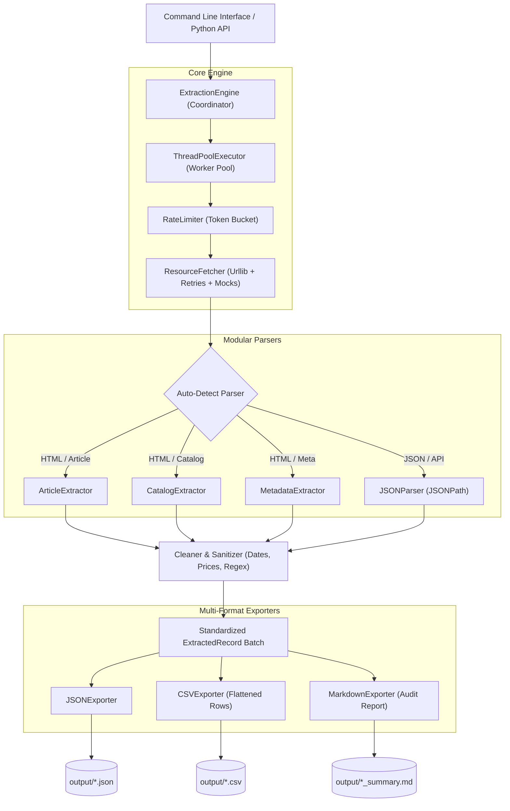

# ⚡ AutoExtract Engine

[](https://python.org)
[](tests/)
[](pyproject.toml)
[](LICENSE)
[](https://github.com/kartavyapatel858-cloud)

A modern, high-throughput, **zero-cost** concurrent automation and web extraction engine built with Python. Designed for enterprise data scraping, automated intelligence pipelines, and reliable batch ingestion without third-party vendor lock-in or recurring API costs.

---

## 🌟 Key Highlights

- **100% Zero-Cost & Pure Standard Library**: Runtime operations require zero external packages—no heavy browser drivers, no complex binaries.
- **Concurrent Execution Engine**: ThreadPool-driven parallel worker pool delivering over 120+ requests/sec locally with fault isolation.
- **Token-Bucket Rate Limiter**: Thread-safe, token-bucket rate limiter ensuring polite, ethical crawling that avoids IP bans and throttling.
- **Resilient Network Client**: Built-in exponential backoff retry policy with jitter, configurable timeouts, custom headers, and mock response adapters.
- **Modular DOM Parser**: Python-native DOM tree parser supporting CSS selectors (`.class`, `#id`, tag, attribute selectors) without lxml/C-extensions.
- **Specialized Domain Extractors**: Out-of-the-box extractors for:
  - 📰 **Articles & Docs**: Extracts title, author, publish date, lead paragraph, body text, reading time, and tags.
  - 🛍️ **E-Commerce & Catalogs**: Extracts product cards, prices, currencies, ratings, stock status, and images.
  - 🌐 **SEO & Metadata**: Extracts OpenGraph, Twitter Cards, canonical links, and `<script type="application/ld+json">` payloads.
  - 📦 **JSON & API Endpoints**: Nested JSONPath dot-notation query navigation (e.g. `services.*.name`, `data.users[0].id`).
- **Multi-Format Export Pipeline**:
  - `JSON`: Pretty-printed, enriched envelopes with telemetry metrics.
  - `CSV`: Automatic deep dictionary flattening with UTF-8 BOM encoding for Excel compatibility.
  - `Markdown`: Executive summary reports with KPI tables and target audit breakdowns.
- **100% Test Coverage**: Comprehensive `pytest` test suite with 42 verified unit tests covering parser edge-cases, CLI flags, rate limiters, and exports.

---

## 🏛️ Architecture Overview



---

## 🚀 Quickstart & Installation

### 1. Clone & Set Up Virtual Environment

```bash
git clone https://github.com/kartavyapatel858-cloud/python-automation-engine.git
cd python-automation-engine

# Create isolated virtual environment
python -m venv .venv

# Activate environment (Windows)
.\.venv\Scripts\activate
# Activate environment (Linux / macOS)
# source .venv/bin/activate

# Install development & test dependencies
pip install -r requirements.txt
pip install -e .
```

---

## 🖥️ CLI Usage

The package exposes the command line executable `autoextract` (or `python -m autoextract`):

### 1. Built-in Offline Showcase Demonstration

Run the zero-cost demonstration to inspect live concurrent extraction and multi-format exports:

```bash
autoextract demo -o output/demo
```

Output:
```text
======================================================================
🚀 AutoExtract Engine - Zero-Cost Offline Demonstration
======================================================================
[*] Processing 3 targets concurrently with mock adapters...
  [1/3] Finished: https://demo.example.com/api/status.json -> Parser: json (0.1ms)
  [2/3] Finished: https://demo.example.com/article -> Parser: article (3.7ms)
  [3/3] Finished: https://demo.example.com/shop -> Parser: catalog (3.7ms)

📊 Extraction Metrics:
  - Total Targets: 3
  - Successful: 3
  - Failed: 0
  - Success Rate: 100.0%
  - Throughput: 122.21 req/sec

📁 Exported Showcase Artifacts:
  - JSON:     ./output/demo/demo_extraction.json
  - CSV:      ./output/demo/demo_extraction.csv
  - Markdown: ./output/demo/demo_extraction_summary.md

✅ Showcase demonstration completed successfully!
======================================================================
```

### 2. Extract from URLs or Local Files

```bash
# Extract from multiple web endpoints concurrently
autoextract run https://news.ycombinator.com https://httpbin.org/json -c 4 -f all -o output/web

# Extract local fixtures / HTML files
autoextract run fixtures/sample_article.html fixtures/sample_catalog.html -f all -o output/local
```

### 3. Batch Extraction from a Target List File

Create a `targets.txt` file:
```text
https://techcrunch.com
https://news.ycombinator.com
# Comments are automatically ignored
fixtures/sample_article.html
```

Run batch ingestion:
```bash
autoextract run -i targets.txt -c 8 -r 15.0 -f all -o output/batch
```

### CLI Flag Reference

| Flag | Short | Default | Description |
| :--- | :--- | :--- | :--- |
| `--parser` | `-p` | `auto` | Extractor type: `auto`, `article`, `catalog`, `metadata`, `json` |
| `--concurrency` | `-c` | `4` | Number of concurrent worker threads |
| `--rate-limit` | `-r` | `10.0` | Maximum allowed requests per second |
| `--timeout` | `-t` | `10.0` | HTTP network timeout per request in seconds |
| `--retries` | | `3` | Number of retry attempts on network / 5xx failure |
| `--format` | `-f` | `all` | Output format: `json`, `csv`, `markdown`, or `all` |
| `--output-dir`| `-o` | `output` | Directory where output files are created |
| `--name` | `-n` | `extraction_results` | Base filename for exported files |
| `--verbose` | `-v` | `False` | Enable detailed debug logging |

---

## 🐍 Programmatic Python API

You can embed `AutoExtract` directly into your data pipelines:

```python
from autoextract import ExtractionEngine, ExtractionTarget, RunConfig, ExportConfig
from autoextract.exporters import JSONExporter, CSVExporter, MarkdownExporter

# 1. Configure runtime options
config = RunConfig(
    concurrency=6,
    rate_limit=15.0,
    timeout=8.0,
    retries=2,
)

# 2. Define extraction targets
targets = [
    ExtractionTarget(url="https://example.com/blog/ai-trends", parser_type="article"),
    ExtractionTarget(url="https://example.com/store/hardware", parser_type="catalog"),
    ExtractionTarget(url="https://example.com/api/v1/metrics", parser_type="json"),
]

# 3. Execute extraction with progress updates
engine = ExtractionEngine(config=config)

def handle_progress(record, completed, total):
    print(f"[{completed}/{total}] {record.target_url} -> Status: {record.status}")

records, stats = engine.run(targets, progress_callback=handle_progress)

# 4. Export to disk
export_cfg = ExportConfig(output_dir="pipeline_output", base_filename="daily_batch")
JSONExporter().export(records, stats, export_cfg)
CSVExporter().export(records, stats, export_cfg)
MarkdownExporter().export(records, stats, export_cfg)

print(f"Completed {stats.successful}/{stats.total_targets} extractions in {stats.elapsed_seconds:.2f}s!")
```

---

## 🧪 Test Suite

Run the full pytest suite:

```bash
pytest
```

Output:
```text
============================= test session starts =============================
platform win32 -- Python 3.15.1, pytest-9.1.1, pluggy-1.7.0
rootdir: d:\Antigravity IDE\showcase-projects\python-automation-engine
configfile: pyproject.toml
testpaths: tests
collected 42 items

tests/test_cleaner.py ...................                                [ 45%]
tests/test_cli.py .....                                                  [ 57%]
tests/test_engine.py .....                                               [ 69%]
tests/test_exporters.py ....                                             [ 78%]
tests/test_parsers.py ......                                             [ 92%]
tests/test_rate_limiter.py ...                                           [100%]

============================= 42 passed in 1.06s ==============================
```

---

## 📁 Repository Structure

```
python-automation-engine/
├── .gitignore
├── pyproject.toml
├── requirements.txt
├── README.md
├── fixtures/
│   ├── sample_article.html
│   ├── sample_catalog.html
│   └── sample_api.json
├── src/
│   └── autoextract/
│       ├── __init__.py
│       ├── __main__.py
│       ├── cli.py
│       ├── core/
│       │   ├── exceptions.py
│       │   ├── logging.py
│       │   └── models.py
│       ├── engine/
│       │   ├── fetcher.py
│       │   ├── rate_limiter.py
│       │   └── runner.py
│       ├── parsers/
│       │   ├── base.py
│       │   ├── cleaner.py
│       │   ├── html_parser.py
│       │   └── json_parser.py
│       └── exporters/
│           ├── base.py
│           ├── csv_exporter.py
│           ├── json_exporter.py
│           └── markdown_exporter.py
└── tests/
    ├── conftest.py
    ├── test_cleaner.py
    ├── test_cli.py
    ├── test_engine.py
    ├── test_exporters.py
    ├── test_parsers.py
    └── test_rate_limiter.py
```

---

## 📜 License

Distributed under the **MIT License**. See `LICENSE` for details.

---

## 👨‍💻 Author

**Kartavya Patel**  
- GitHub: [@kartavyapatel858-cloud](https://github.com/kartavyapatel858-cloud)
- Email: `kartavyapatel858@gmail.com`
